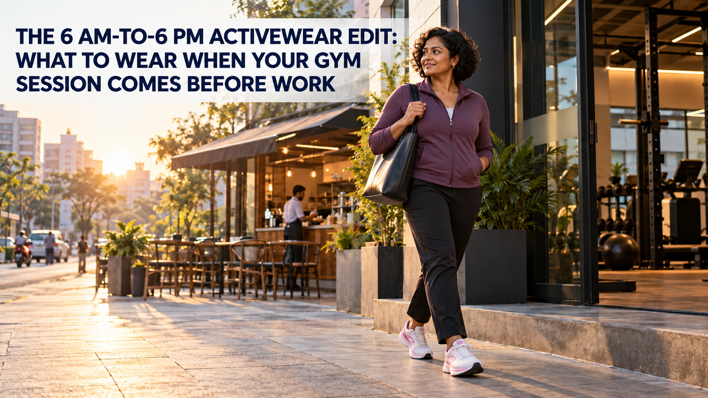

**Meta Title:** Gym-to-Work Activewear Edit: Gladiator Shoes & More | OFFLIMITS  
**Meta Description:** Build a practical gym-to-work outfit around OFFLIMITS Gladiator shoes, a fresh change and a workday layer that suits your office.

# The 6 AM-to-6 PM Activewear Edit: What to Wear When Your Gym Session Comes Before Work

At 6 AM, the question is whether you can get to the gym on time. By 8 AM, it is whether the clothes in your bag will get you through a commute and a workday. The trick is not to wear your sweaty workout kit to the office. It is to decide what can stay, what needs changing and what your workplace actually allows.

Start with the shoes you need for the session. Then build a small change of clothes around them. That is a more useful gym-to-work activewear plan than hoping one outfit will do everything.

## Before you pack: how dressy is work today?

If your office is casual, clean trainers, neat joggers and a fresh top may fit in. If you have client meetings or a stricter dress code, pack proper work trousers or another complete outfit. There is no styling trick that turns damp leggings into officewear.

This decision also tells you what stays on your feet. OFFLIMITS lists the [men’s Gladiator in Black](https://offlimits.co.in/products/gladiator-black-orm-661-01) and [Gladiator For Her in Off-White/Pink](https://offlimits.co.in/products/gladiator-for-her-off-white-pink-orw-678-03) for running, workouts and active daily wear. Both product pages list a memory-foam insock and Phylon/TPR sole. If trainers are acceptable at work, these are two Gladiator options to consider for a movement-led morning. If not, carry your work shoes too.

## 6 AM: dress for the workout, not the desk

For a treadmill run or cardio session, choose a top and bottoms you can move and sweat in. For strength work, choose a fit that stays put through the movements you have planned. You can browse [men’s shorts](https://offlimits.co.in/collections/men-shorts) or [women’s tights](https://offlimits.co.in/collections/women-tights) for the workout portion, but do not let the possibility of wearing the same bottoms later dictate your training kit.

Gladiator is the footwear anchor here, not a promise that one shoe is ideal for every sport. Check the listed use of the exact pair against your session. If you are choosing between a running-led and a gym-led shoe, the OFFLIMITS guide to [running shoes versus gym shoes](https://offlimits.co.in/blogs/blogs/running-vs-gym-shoes-uncover-the-difference-between-running-vs-gym-shoes) is a useful next read.

## After the shower: make a real change

Pack a clean top, fresh socks and the work bottoms you need for the day. After a sweaty session, change out of damp layers rather than covering them with a jacket. A small pouch for the used kit will keep it separate from the rest of your bag.

For a relaxed office, the change could be a plain tee or polo with clean [men’s joggers and track pants](https://offlimits.co.in/collections/men-joggers-track-pants) or another neat pair you already own. A structured overshirt or jacket makes the outfit look more deliberate. For a dressier workplace, change into your regular work clothes. You can still keep the Gladiator shoes for the commute and swap footwear at the office if needed.

## From commute to 6 PM: keep the styling quiet

Black, charcoal, navy and off-white are easy to repeat across the week. A clean top, simple outer layer and bag that fits your day will do more than piling on extra gym accessories. The shoes can remain the sporty detail if your workplace permits them.

For example, a man doing a short morning run could wear black Gladiator shoes with training shorts, then change into fresh socks, a plain polo and clean dark trousers. A woman in Gladiator For Her could train in tights and a performance tee, then change into a fresh top and straight-leg trousers under a light jacket. Both outfits are built around a genuine change, not around pretending the 6 AM clothes are still fresh at 6 PM.

## Final thoughts

A gym-before-work wardrobe works when it respects both halves of the day. Train in clothes suited to your session, change what needs changing and let your office dress code decide whether the trainers stay on.

If the Gladiator line fits your workout and your day, explore [Gladiator in Black for men](https://offlimits.co.in/products/gladiator-black-orm-661-01) or [Gladiator For Her in Off-White/Pink](https://offlimits.co.in/products/gladiator-for-her-off-white-pink-orw-678-03), then choose the pair that fits your own routine.

## FAQs

### Can I wear Gladiator shoes to work after the gym?

That depends on your office dress code. If clean trainers are welcome and the pair suits your workout, they can stay on for the commute and workday. Otherwise, pack work shoes.

### What should I pack for a gym session before work?

At minimum, pack a clean top, fresh socks, any work clothes your office requires, basic toiletries and a separate pouch for your used kit.

### Can I keep my workout joggers on all day?

Only if they are clean and dry and your workplace allows them. After a sweaty session, changing the bottoms is the more practical choice.

## Image metadata

- Hero alt text: A short-haired Indian woman in a plum jacket, black trousers and white-pink shoes leaving the gym for work, with the article title.
- File name: `offlimits-6am-6pm-hero-v2.png`
- Product visual reference: OFFLIMITS Gladiator For Her Off-White/Pink. Generated editorial shoe depiction is not an exact product photograph.

## Keywords used

- Primary: gym to work activewear
- Secondary: activewear for work, gym outfit before work, Gladiator shoes, athleisure outfits India
