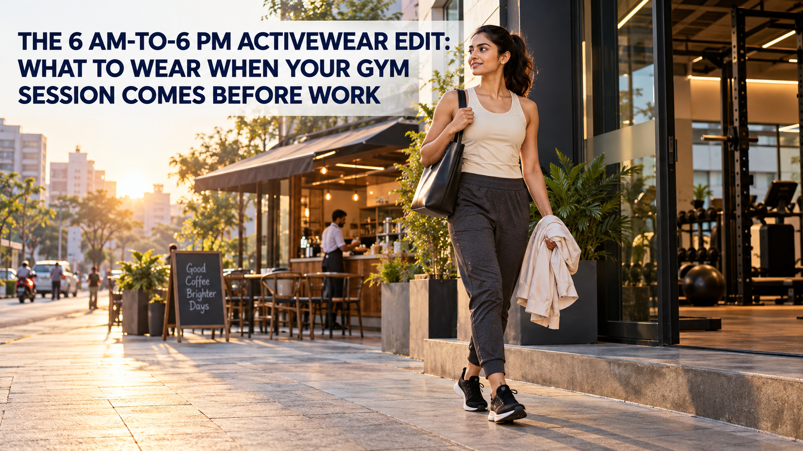

**Meta Title:** Gym-to-Work Activewear Edit: Gladiator Shoes & More | OFFLIMITS  
**Meta Description:** Build a practical gym-to-work outfit around OFFLIMITS Gladiator shoes, smart layers and repeatable activewear for a 6 AM-to-6 PM day.

# The 6 AM-to-6 PM Activewear Edit: What to Wear When Your Gym Session Comes Before Work

The early gym session is the easy part. The difficult bit arrives afterwards: you have a commute, a desk, a coffee run and possibly an evening plan before you get home. A useful gym-to-work outfit is not about pretending workout clothes are formalwear. It is about choosing a few clean, comfortable pieces that can handle the session first, then look considered for the rest of the day.

Start from the ground up. The [OFFLIMITS Gladiator in Black](https://offlimits.co.in/products/gladiator-black-orm-661-01) is the hero of this edit: its current product page lists a knitted upper with KPU overlay, a memory-foam insole and a Phylon rubber sole. That makes it a natural place to start when your morning includes a treadmill, an easy run or a mixed gym session, then you need to keep moving through the city.

## Quick answer: what makes an outfit work from gym to work?

Pick one workout-ready base, one cleaner layer and footwear that suits your actual training. The clothes should let you move first; the styling comes from a restrained colour palette, a tidy silhouette and a fresh top for the workday.

## The Gladiator category: your anchor for a long day

Gladiator is not a shoe you hide under an outfit. It is the piece that keeps the whole edit connected. The knitted upper brings a more textured, athletic finish than a flat casual sneaker, while the KPU overlay adds structure. Inside, the memory-foam insole changes the feel toward softer, more conforming comfort.

For a gym-led morning, pair [Gladiator](https://offlimits.co.in/products/gladiator-black-orm-661-01) with a plain performance tee and tapered joggers. After the workout, swap the training tee for a clean overshirt, polo or structured layer. The shoes remain the sporting element; everything above them gets quieter.

Women can take the same idea into the [Gladiator For Her](https://offlimits.co.in/products/gladiator-for-her-off-white-pink-orw-678-03), which OFFLIMITS lists with a Flyknit upper, memory-foam insole and Phylon/TPR sole. A simple fitted top, dark tights or relaxed joggers, and an open jacket is enough to make the transition feel intentional.

## 1. Choose the right workout base

At 6 AM, do not dress for an imaginary workday. Dress for your workout. If you are doing cardio or a treadmill session, begin with a breathable tee and shorts or joggers that let you move. If strength training is the plan, a secure base layer and bottoms that stay put through squats, lunges and bends will save you a lot of fuss.

OFFLIMITS apparel gives you the useful building blocks: [men’s joggers and track pants](https://offlimits.co.in/collections/men-joggers-track-pants), [men’s sports shorts](https://offlimits.co.in/collections/men-shorts), training tees and co-ords. Pieces that use Wicktech should be chosen when the product page specifically names it; that is the moisture-management detail to look for on a sweat-heavy morning.

## 2. Make the commute layer do the visual work

The fastest way to make an active outfit feel more work-ready is an outer layer with a clear shape. A track jacket, clean overshirt or co-ord top gives the base outfit a finish without asking you to pack a full change of clothes.

Keep the colour story simple: black Gladiator shoes, charcoal joggers and a neutral tee already make a strong base. Add one layer in navy, olive, grey or off-white. That is enough contrast to feel dressed, not over-styled.

## 3. Pack one fresh top, not a whole second wardrobe

The best gym-bag rule is simple: change the piece that carries the most of the workout. A clean tee, polo or light shirt can reset the outfit in two minutes. Keep the joggers and Gladiator shoes if they still feel right for your day.

This is also where you should be honest about the session. If you finish a high-sweat workout, change out of the damp base before the commute. A gym-to-work wardrobe works because it is practical, not because it asks you to ignore comfort.

## 4. Let the shoe match the session, not just the desk

Gladiator makes sense when you want one pair that begins with movement. If your weekday is mostly lifting, court sport or a formal office environment, a different shoe may be the better call. The useful question is not “Can I wear this everywhere?” It is “What will I actually do in it before I reach my desk?”

Use the [OFFLIMITS running versus gym shoes guide](https://offlimits.co.in/blogs/blogs/running-vs-gym-shoes-uncover-the-difference-between-running-vs-gym-shoes) if you are deciding between a running-led and gym-led pair. It is a better starting point than choosing by colour alone.

## Three 6 AM-to-6 PM formulas

### Treadmill, commute, desk

Black Gladiator + dark joggers + breathable tee for the run. Pack a fresh neutral tee and add a track jacket after your shower.

### Strength session, meetings, dinner

Gladiator + a fitted training top + tapered joggers. Replace the top with a clean polo or overshirt; keep the shoes and bottom as the consistent base.

### Walk, coffee, work-from-anywhere

Gladiator For Her + dark tights or relaxed cargo pants + a simple fitted tee. Add an open co-ord jacket or overshirt for a sharper outer line.

## Final thoughts

The best gym-to-work activewear edit is built around the morning you truly have. Choose your shoe for the workout, keep the base clean, add one structured layer and carry one fresh top. Gladiator gives the outfit a performance-first anchor; the rest is about making the transition feel easy.

Explore the [OFFLIMITS running and gym footwear range](https://offlimits.co.in/collections/men-running-shoes) and build a rotation that works from your first set to your final meeting.

## FAQs

### Can Gladiator shoes work for both gym and daily wear?

Gladiator can anchor a gym-to-work look when the product’s listed use suits your planned session. Pair it with clean joggers and a fresh top for the transition after training.

### What should I pack for a gym session before work?

Pack one fresh top, basic toiletries and the layer you plan to add after training. Keep the workout base simple enough that only the upper half needs a reset.

### Are joggers suitable for work after the gym?

Tapered joggers in a neutral colour can work for a casual or flexible workplace when paired with a clean top and structured outer layer.

## Keywords used

- Primary: gym to work activewear
- Secondary: activewear for work, gym outfit before work, Gladiator shoes, athleisure outfits India
