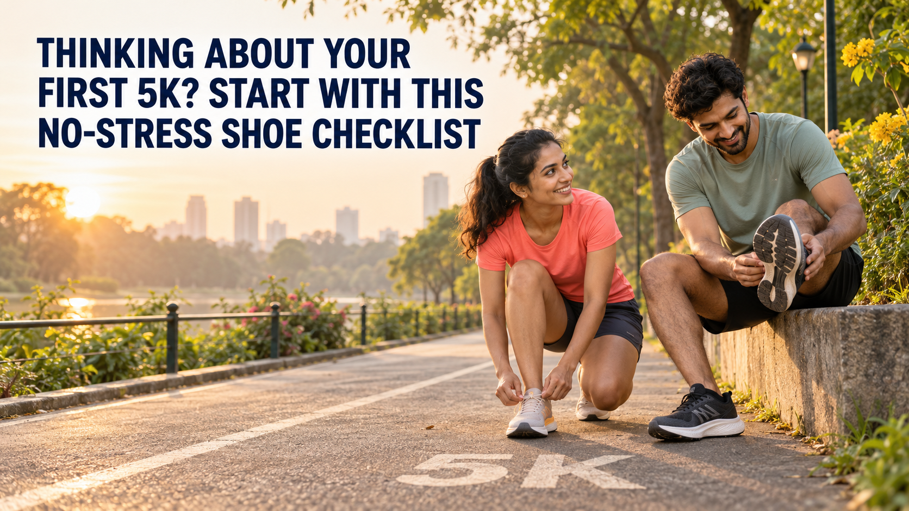

**Meta Title:** First 5K Running Shoes: A No-Stress Checklist | OFFLIMITS  
**Meta Description:** Training for your first 5K? Use this practical shoe checklist to choose a comfortable OFFLIMITS running pair for your early runs, walks and race day.

# Thinking About Your First 5K? Start With This No-Stress Shoe Checklist



You have picked a 5K. Now you are looking at shoes and wondering whether you need to understand every foam, sole and training term before your first run. You do not. Your shoes have one immediate job: feel comfortable enough for the walk-run sessions you will actually do.

The easiest way to choose is to work backwards from your route and your feet. Here is a first 5K shoe checklist you can use without turning a new hobby into homework.

## First, picture an ordinary training day

Will most of your sessions happen on a pavement, a park path or a treadmill? Will you alternate walking and running? Choose for that routine, not just for race morning. If running is the main activity, begin with a shoe the brand lists for running. OFFLIMITS has separate [men’s running shoes](https://offlimits.co.in/collections/men-running-shoes) and [women’s running shoes](https://offlimits.co.in/collections/women-running-shoes) to browse by intended use.

If your week mixes short runs with gym sessions, check the product description before assuming one pair suits both. The OFFLIMITS guide to [running shoes versus gym shoes](https://offlimits.co.in/blogs/blogs/running-vs-gym-shoes-uncover-the-difference-between-running-vs-gym-shoes) explains why the two categories are not always interchangeable.

## The five checks that matter

### 1. Make room for your toes

Try shoes on with the socks you plan to run in. Stand and walk, rather than judging the fit while seated. Your toes should have room to move; the front should not feel cramped. If one foot is larger, fit that foot first. Do not count on a tight pair stretching into the right size.

### 2. Check that your heel stays put

Walk briskly and take a few easy steps in the shoes. A heel that slips or a midfoot that feels loose will keep asking for your attention. The fit should be secure without squeezing. If you are shopping online, try the pair indoors on a clean floor before deciding to keep it.

### 3. Notice the feel, not just the feature list

Some people like a softer feel inside the shoe; others prefer a less padded one. Neither preference makes you a better runner. The [Gladiator in Black for men](https://offlimits.co.in/products/gladiator-black-orm-661-01) is listed for running and gym use and has a memory-foam insock and Phylon/TPR sole. For women, [Gladiator For Her in Black/White](https://offlimits.co.in/products/gladiator-for-her-black-white-orw-678-01) is also listed for running and workouts, with a memory-foam insock and Phylon/TPR sole. These details help you make a shortlist; the fit test still decides whether a shoe works for you.

### 4. Give the pair an ordinary test run

Wear your new shoes for a walk, then an easy training session. Notice whether the upper rubs, the heel shifts or you keep stopping to retie the laces. If something feels wrong in a short session, do not save the problem for race day. Your first 5K should be in a pair you already know, not one you have only worn around the house.

### 5. Inspect the shoes you already own

You may not need to buy anything. If an existing running pair still fits well and feels comfortable on your current sessions, keep using it. If the outsole is heavily worn, the cushioning feels noticeably different or the fit has changed, compare it with the [signs it is time to replace your workout shoes](https://offlimits.co.in/blogs/blogs/7-signs-it-s-time-to-replace-your-workout-shoes). Do not replace shoes solely because a date on the calendar says you should.

## So, what should you buy?

Start with the pair that passes those five checks. If you have no running shoes yet, shortlist a running-labelled style in your size, try it with your usual socks and test it in a few easy sessions. If you already have a comfortable pair, spend your energy on getting out the door rather than shopping for a supposed race-day upgrade.

There is no need to match somebody else’s pace, outfit or shoe choice. A first 5K can include plenty of walking. The right footwear is the pair that lets you focus on that experience instead of on your feet.

## Final thoughts

Choose for your regular route, check the fit while moving and give the shoes time to prove themselves before the event. That is enough of a plan for your first starting line.

Ready to compare options? Browse [OFFLIMITS running shoes for men](https://offlimits.co.in/collections/men-running-shoes) or [running shoes for women](https://offlimits.co.in/collections/women-running-shoes), then choose the pair that fits your own routine.

## FAQs

### Do I need a special race shoe for my first 5K?

No. A comfortable shoe listed for running, which you have worn during training, is a more useful starting point than an unfamiliar race-day pair.

### Can I walk and run in the same shoes?

Yes, if the running shoe feels comfortable during both parts of your walk-run sessions. Test it in the routine you intend to follow.

### Should new running shoes feel tight?

No. Your heel and midfoot should feel secure, but the upper should not pinch and your toes need space to move.

## FAQ JSON-LD

```json
{
  "@context": "https://schema.org",
  "@type": "FAQPage",
  "mainEntity": [
    {"@type":"Question","name":"Do I need a special race shoe for my first 5K?","acceptedAnswer":{"@type":"Answer","text":"No. A comfortable shoe listed for running, which you have worn during training, is a more useful starting point than an unfamiliar race-day pair."}},
    {"@type":"Question","name":"Can I walk and run in the same shoes?","acceptedAnswer":{"@type":"Answer","text":"Yes, if the running shoe feels comfortable during both parts of your walk-run sessions. Test it in the routine you intend to follow."}},
    {"@type":"Question","name":"Should new running shoes feel tight?","acceptedAnswer":{"@type":"Answer","text":"No. Your heel and midfoot should feel secure, but the upper should not pinch and your toes need space to move."}}
  ]
}
```

## Image metadata

- Hero alt text: Two Indian beginners getting ready for a park run, with the article title.
- File name: `offlimits-first-5k-hero.png`

## Keywords used

- Primary: first 5K running shoes
- Secondary: running shoes for beginners, first 5K shoe checklist, running shoes India, beginner running shoes
