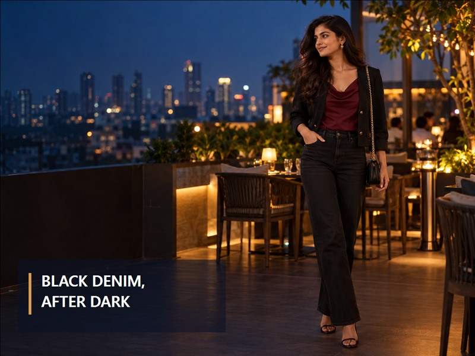

# Black Jeans Outfit Ideas for Women: 8 Polished Looks for Dinner and Evening Plans

Dinner plans can land on a weekday, follow a long day out or turn into a festive catch-up with friends. Black jeans make a useful starting point because they feel relaxed while their darker colour works easily with sharper layers and evening accessories. The key is to make each pairing look deliberate: balance the jean’s shape, choose one texture or detail to lead, and finish with shoes that suit the venue. These black jeans outfit ideas for women focus on eight wearable combinations, not a full wardrobe change. Use them as a starting point, then make the proportions your own.

## Start with the black jeans silhouette

Before choosing a blouse or jacket, check the rise, leg shape and hem. A clean high-rise pair gives a tucked-in blouse a clear finish; a straight leg leaves room for a fluid blouse or light jacket; a super-skinny cut can balance a looser layer. Spykar’s live collection includes both the [Alexa super-skinny high-rise jeans in jet black](https://spykar.com/products/wdale1bf301jetblack) and [Bella straight-fit high-rise black jeans](https://spykar.com/products/wdynr2bd068jetblack). Their product pages list those fits and rises; the styling below is outfit guidance, not a claim that one silhouette suits everyone.

*Spykar Women Alexa super-skinny fit, jet-black, high-rise jeans. Image source: Spykar product page.*

## 8 black jeans outfit ideas for women

### 1. A tonal black base with a bright earring

Pair straight black jeans with a black square-neck blouse or fine knit, then add one vivid earring or a slim metallic cuff. The tonal base keeps the outfit composed; the single bright detail makes it feel ready for dinner. Pointed flats or a low heel keep the hem visible and make this an easy choice for a restaurant where you will be walking between stops.

### 2. A jewel-colour blouse with a clean slim fit

Choose a blouse in emerald, plum or deep blue and tuck the front into slim black denim. Keep the blouse’s shape simple if the colour is already doing the work. A small shoulder bag and heeled sandals finish the look without competing with the neckline. For an evening plan that includes a festive gathering, add a delicate pendant rather than piling on several statement pieces.

### 3. A waistcoat and wide-leg denim

A tailored waistcoat brings structure to wide-leg black jeans. Wear it over a fitted tee or tank, define the waist with a narrow belt and let the wider hem fall over a neat block heel. This balance gives the outfit movement below and a clear line through the shoulders. If the waistcoat is patterned, keep the bag and jewellery quiet.

### 4. A soft embroidered blouse with straight-fit jeans

Let a small area of embroidery or lace add texture against black denim. A cropped or waist-length blouse pairs naturally with straight-fit jeans; if the blouse is longer, try a partial tuck to show where the waist begins. Finish with understated flats or a modest heel, and pick up one thread colour in your earrings or bag. The result suits an informal dinner or a family evening without feeling overdone.

*Spykar Women Bella straight-fit, black, high-rise jeans. Image source: Spykar product page.*

### 5. A short structured jacket over a simple tee

Use a short jacket to sharpen a plain crew-neck tee and black jeans. A hem that stops near the waistband keeps the outfit’s proportions clear, especially with a straight or relaxed leg. Choose a texture—such as a subtle weave or soft suiting fabric—and let that be the main detail. Loafers make the look relaxed; a closed-toe heel moves it towards dinner.

### 6. A printed blouse with sleek shoes

Small-scale prints can lift a black jeans evening outfit without requiring bright accessories. Try a fluid blouse with a black or dark-ground print, then keep the belt and bag simple. With slim denim, a slingback or pointed flat adds a crisp finish; with a wider leg, choose a shoe with enough sole or heel to keep the hem from dragging. Check the length while standing and sitting before heading out.

### 7. A fine metallic knit for a celebratory plan

For a festive dinner, pair clean black denim with a fine metallic-thread knit or a blouse with a restrained sheen. Keep the jeans and outer layer understated so the light-catching texture has space. Small hoops and a compact bag are enough; switch to comfortable block heels if the evening includes standing or moving between venues. This is an easy way to bring celebration into everyday denim without dressing for a more formal event than the invitation calls for.

### 8. A crisp white shirt with a contrasting layer

Start with a white shirt tucked into high-rise black jeans, then add a cropped jacket in a contrasting colour—deep green, wine or warm brown. Roll the cuffs once and keep the collar relaxed. A slim belt and simple heeled sandals or polished flats make the outfit feel considered, while the shirt keeps it comfortable for an unplanned extension to the evening.

## Small finishing choices that change the mood

An evening outfit often comes together through proportion and finish rather than extra pieces. Keep these quick checks in mind:

- If the jeans are fitted, try a more relaxed shirt or jacket; with a wider leg, a tucked or shorter blouse can restore balance.
- A clean, darker-looking wash reads more composed than a heavily distressed pair for most dinner plans.
- Match the shoe to the hem: check that a wide leg clears the floor and that a cropped hem works with the footwear you plan to wear.
- Choose one focal point—shine, print, colour or jewellery—then let the other details support it.

For more ideas on using different fits across occasions, see Spykar’s guide to [women’s jeans for workdays, weekends and festive evenings](https://spykar.com/blogs/blog/womens-jeans-every-plan). This article stays focused on dinner and night-time combinations, while the wider guide helps plan a small rotation across the week.

## Denim for all moments, including evenings

Spykar’s AW26 thought, “Denim For All Moments”, is about wearing denim through festive plans, outings, catch-ups with friends, a first job, the first day of college and reunion parties. An evening look can be one part of that rotation: keep the jeans comfortable, then shift the mood with the blouse, layer and shoes. Choose the outfit that lets you move easily and still feels like you. When you are ready to build that rotation, [explore Spykar’s women’s black-jeans collection](https://spykar.com/collections/black-jeans-women) and compare the available fits for your plans.

## FAQs

### What tops go with black jeans for dinner?

Try a jewel-colour blouse, a crisp shirt, a fine knit or a simple fitted tee with one distinctive accessory.

### How do I make black jeans look more polished for evening?

Start with a clean-looking pair, balance the blouse or layer with the leg shape and finish with a considered shoe and one focal accessory.

### Can I wear black jeans to a festive dinner?

For an informal festive plan, black jeans can work with a textured or softly embellished blouse. Follow the host’s dress code if the event is more formal.

### Which shoes work with black jeans at night?

Pointed flats, slingbacks, block heels and heeled sandals can all work. Choose by venue, walking distance and the jeans’ hem length.

### What jacket should I wear with black jeans for dinner?

A short structured jacket sharpens a simple base, while a longer relaxed layer can work when the outfit beneath it stays neat and balanced.

## Conclusion

Black jeans can move into dinner plans without losing their ease. Begin with the fit and hem, then build around one clear idea: a jewel-colour blouse, a waistcoat, a crisp shirt or a hint of evening texture. The eight formulas here are meant to be adapted to your own comfort, venue and personal style—not followed as fixed rules. Spykar’s AW26 “Denim For All Moments” brings that versatility into focus, from a festive evening or catch-up with friends to everyday plans beyond the celebration. Explore the [women’s black-jeans collection](https://spykar.com/collections/black-jeans-women) to find a silhouette that feels right for your next plan.
