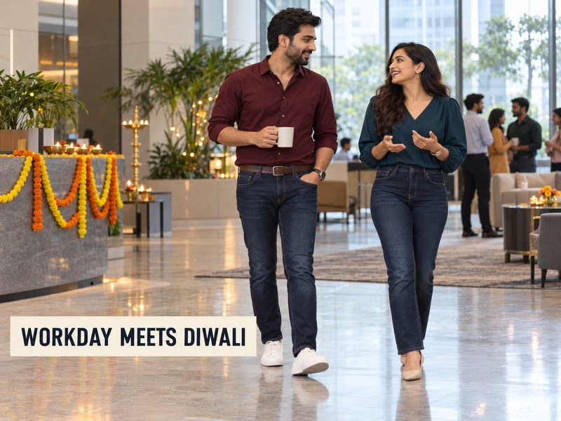

# Diwali Office Party Outfit Ideas: Smart-Casual Denim Looks for Men and Women



An office Diwali party has a narrow sweet spot: festive enough for the celebration, comfortable through the workday and still right for your workplace. These Diwali office party outfit ideas start with one practical question—does your invite allow smart-casual or western wear? If it does, a clean pair of dark jeans can make a useful base. A rich-coloured shirt or blouse, a defined fit and one considered accessory bring the festive note without turning a desk-to-dinner plan into a costume change.

## Check the office dress code before choosing denim

Read the invitation and think about the setting. A traditional-wear theme, a formal client event or a puja with a stated dress expectation calls for something else. If the party is a relaxed gathering after work, dark denim may fit—but keep the finish clean and the rest of the outfit composed.

The venue matters too. A celebration in the office cafeteria asks for a different level of polish from an evening event at a hotel. When in doubt, ask a colleague or organiser. A simple shirt-and-jeans look is easiest to adapt, but the written dress code comes first.

## Start with dark denim and a clear fit

Black or dark indigo jeans give bright festive colours room to stand out. Choose a clean, even wash without heavy distressing, and check the fit while sitting as well as standing. The waistband should stay in place; the hem should meet your shoes without pooling; and the leg should feel easy enough for a long day.

For a smart-casual office party, straight, regular or gently relaxed shapes are usually easier to dress up than an exaggeratedly wide or skin-tight fit. A dark pair also works well with a light shirt, a jewel-tone blouse or a tailored layer. Spykar’s [Men Ikemen loose-fit dark blue jeans](https://spykar.com/products/mdact2bf347darkblue) are one relaxed option to consider when your office is comfortable with a looser silhouette.


*Spykar Men Ikemen loose-fit dark blue jeans, shown as a relaxed denim option.*

## Diwali office party outfit ideas for women

### Dark jeans with a jewel-tone blouse

Pair dark straight or bootcut jeans with a blouse in wine, emerald, teal or rust. A tucked front or a hem that ends around the waistband helps define the shape. Finish with small gold-toned earrings, a clean belt and block heels or pointed flats you can comfortably walk in.

### A crisp shirt with a short festive layer

A white, ivory or pale-blue shirt keeps the base work-ready. Add a short jacket, a structured waistcoat or a lightweight festive layer for the party. Keep the shirt simple if the outer layer has embroidery or a strong print; one focal point is enough for the look to feel considered.

### A darker base with one bright accessory

Black or dark-blue denim with a black blouse or tee creates a quiet base for a colourful bag, a bold earring or a scarf in marigold or red. This is a good route when you want the outfit to feel festive in photographs without wearing a bright colour from head to toe. Spykar’s [women’s jeans collection](https://spykar.com/collections/women-jeans) includes dark shades across several fits, so start with the silhouette that feels natural for you.


*A dark-blue wide-leg option from Spykar’s women’s jeans collection.*

## Diwali office party outfit ideas for men

### Dark jeans with an ivory or pale-blue shirt

This is the straightforward option for a smart-casual office. Tuck in a solid shirt, add a belt that works with your shoes, and leave the collar open if a tie is not part of the dress code. Loafers or clean low-profile shoes make the finish feel deliberate.

### Black denim with burgundy, rust or bottle green

A rich shirt gives black jeans a festive edge while the dark base keeps the look grounded. Choose a regular or slim-straight shape with a clean hem. If you add a blazer, keep it unstructured and easy to move in; a formal suit jacket can feel out of place beside casual denim.

### A relaxed shirt for a casual workplace

Where the invitation is clearly casual, try a textured shirt or a restrained print with dark indigo jeans. Keep the pattern small, the shoes clean and the accessories simple. Spykar’s loose-fit Ikemen option shown above has more volume through the leg, so it suits a relaxed workplace better than an office with a conventional business-casual dress code.

For more shirt-and-denim combinations, see Spykar’s [guide to styling jeans with shirts](https://spykar.com/blogs/blog/how-to-style-jeans-with-shirts-smart-casual-outfit-ideas). It covers ways to adjust the same base with colour, fit and proportion.

## Small changes that take a look from desk to celebration

You do not need a second outfit for every office gathering. Plan one or two changes that fit in your bag or desk drawer:

- Swap everyday shoes for loafers, block heels or clean dress sneakers if the venue allows them.
- Add one festive detail, such as a pocket square, earrings, a slim scarf or a brighter bag.
- Carry a light jacket or layer if the evening venue is cooler than the office.
- Check your hem and shirt tuck after sitting; a quick mirror check can reset the proportions.

Keep the workday base comfortable. If a belt digs in when you sit or a shirt pulls at the shoulders, the outfit will feel wrong well before the party begins. A comfortable fit is part of the smart-casual finish.

## Denim For All Moments: the Spykar AW26 idea

Spykar’s AW26 Collection uses the tagline “Denim For All Moments”. The idea is that denim can move with the occasions that make up a life: festive celebrations, outings, catch-ups with friends, a first job, the first day of college and reunion parties. An office Diwali gathering belongs in that mix too. Start with a denim fit you can wear through the workday, then use colour, a shirt or blouse and a few details to match the celebration. The same pair can return for another plan when the lights come down.

## Dress for the invite, then move on with your evening

The right Diwali office party outfit depends on the invitation, the workplace and how you want to feel after a full day. If smart-casual denim suits the setting, choose a clean dark wash, check the fit while seated and let one festive colour or accessory do the extra work. Men can start with a shirt and considered shoes; women can build around a blouse, crisp shirt or shorter festive layer. Explore Spykar’s [men’s jeans](https://spykar.com/collections/men-jeans) and [women’s jeans](https://spykar.com/collections/women-jeans) to find a fit that can carry more than one moment.

## Frequently asked questions

### Can I wear jeans to a Diwali office party?

Yes, if the invitation and workplace dress code allow smart-casual or western wear. Choose a clean, dark wash and a polished shirt or blouse.

### What colour jeans work for an office Diwali party?

Black or dark indigo is easy to pair with festive colours and usually reads more composed than a heavily faded or distressed wash.

### What should women wear with jeans to an office Diwali party?

A jewel-tone blouse, crisp shirt or short festive layer can work with dark straight or bootcut jeans. Match the look to the event’s dress code.

### What should men wear with jeans to an office Diwali party?

Try dark jeans with an ivory, pale-blue or rich-coloured shirt, plus a belt and clean loafers or dress sneakers where appropriate.

### How can I make a denim outfit feel festive without overdoing it?

Choose one focal detail: a rich-coloured shirt or blouse, a small print, a festive layer or a bright accessory. Let the rest of the outfit stay simple.

### Can I wear the same jeans from work to the party?

If denim is allowed at work and at the event, yes. Keep the base comfortable and use a small change in footwear or accessories to shift the mood.

## FAQPage schema

```json
{
  "@context": "https://schema.org",
  "@type": "FAQPage",
  "mainEntity": [
    {"@type":"Question","name":"Can I wear jeans to a Diwali office party?","acceptedAnswer":{"@type":"Answer","text":"Yes, if the invitation and workplace dress code allow smart-casual or western wear. Choose a clean, dark wash and a polished shirt or blouse."}},
    {"@type":"Question","name":"What colour jeans work for an office Diwali party?","acceptedAnswer":{"@type":"Answer","text":"Black or dark indigo is easy to pair with festive colours and usually reads more composed than a heavily faded or distressed wash."}},
    {"@type":"Question","name":"What should women wear with jeans to an office Diwali party?","acceptedAnswer":{"@type":"Answer","text":"A jewel-tone blouse, crisp shirt or short festive layer can work with dark straight or bootcut jeans. Match the look to the event’s dress code."}},
    {"@type":"Question","name":"What should men wear with jeans to an office Diwali party?","acceptedAnswer":{"@type":"Answer","text":"Try dark jeans with an ivory, pale-blue or rich-coloured shirt, plus a belt and clean loafers or dress sneakers where appropriate."}},
    {"@type":"Question","name":"How can I make a denim outfit feel festive without overdoing it?","acceptedAnswer":{"@type":"Answer","text":"Choose one focal detail: a rich-coloured shirt or blouse, a small print, a festive layer or a bright accessory. Let the rest of the outfit stay simple."}},
    {"@type":"Question","name":"Can I wear the same jeans from work to the party?","acceptedAnswer":{"@type":"Answer","text":"If denim is allowed at work and at the event, yes. Keep the base comfortable and use a small change in footwear or accessories to shift the mood."}}
  ]
}
```
