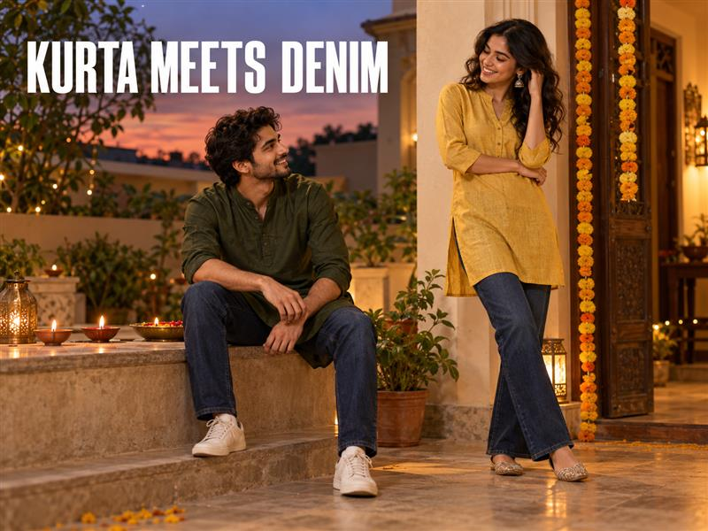

# How to Style a Kurta with Jeans for Diwali: Casual Fusion Looks That Feel Considered



Diwali dressing does not have to mean choosing between a full traditional set and everyday western wear. A kurta with jeans for Diwali can sit comfortably between the two when the invitation allows casual fusion dressing. The key is proportion: let the kurta set the mood, then choose denim that keeps the outfit balanced. A clean wash, a considered hem and one festive detail are often enough. These ideas cover men and women, with simple ways to make the same jeans-and-kurta combination feel right for a family visit, a relaxed office celebration or an evening catch-up.

## Begin with the plan, not the outfit

Before picking a kurta, check where you are going and what the host expects. A home visit or a casual Diwali get-together may suit a denim-led fusion outfit. A formal puja, religious venue or invitation with traditional attire specified calls for a different choice. When you are unsure, ask rather than assume.

Spykar’s [Ganesh Chaturthi denim guide](https://spykar.com/blogs/blog/ganesh-chaturthi-denim-looks) also treats the setting as the first styling decision. Keep that same practical check for Diwali: the jeans-and-kurta combination is most useful when the event is relaxed enough for it.

## Match the jeans to the kurta’s length

A practical way to make a kurta and jeans outfit feel intentional is to balance the amount of fabric above and below the waist.

- A short or hip-length kurta leaves more of the jeans visible, so straight, slim-straight or relaxed jeans can all work. Pick the shape that feels comfortable and sits neatly at the waist.
- A mid-thigh kurta usually pairs easily with a clean straight or gently tapered leg. The simpler outline keeps the longer kurta from making the outfit feel crowded.
- With a longer kurta, try a cleaner, narrower leg and a dark wash. Skip excess stacking at the ankle so the hem and footwear remain visible.

These are starting points, not rules. Try the full combination while standing and sitting; check that the kurta does not bunch at the waistband and that the jeans feel comfortable when you move.


*Spykar Men Chico Jeans Relaxed Fit Black Mid Rise: a clean dark-denim option to consider with a festive kurta.*

## Kurta with jeans for men: keep one piece relaxed

For a short kurta in ivory, rust or a deep festive colour, dark straight or relaxed jeans make a grounded base. Keep the kurta untucked, let its hem fall naturally, and choose footwear that fits the event: clean loafers for a contemporary gathering or traditional slip-ons when they suit the venue.

If the kurta is longer or has a strong print, try a simpler dark jean rather than adding another statement layer. Spykar’s [Men Chico relaxed-fit black jeans](https://spykar.com/products/mdynr1bf149carbonblack) are a live product example of a clean black, mid-rise relaxed silhouette. The product page identifies the fit and wash; the outfit pairing here is a styling suggestion, not a product claim.

An open denim jacket can work over a plain, shorter kurta for a casual evening with friends, but keep the washes distinct. If both pieces are blue, put a lighter tee or vest between them. For more ideas on balancing denim layers, see Spykar’s [jeans-and-shirts styling guide](https://spykar.com/blogs/blog/how-to-style-jeans-with-shirts-smart-casual-outfit-ideas).

## Kurta with jeans for women: work with the silhouette

A short kurti or kurta gives wide-leg or straight jeans room to show their shape. Try a solid kurta with a high-rise wide leg, then add one detail—small jhumkas, a slim belt or a compact festive bag. If the kurta is longer and fluid, a straight jean can create a calmer line beneath it.

Print and embroidery already bring texture, so let the denim stay clean. A simple kurta can take a brighter accessory or a richer colour. Spykar’s [Women Bella-Wide dark-blue jeans](https://spykar.com/collections/women-jeans/products/wdynr2bf276darkblue) are listed as a high-rise, wide-leg fit and offer one option to try with a shorter kurta.


*Spykar Women Bella-Wide Jeans Wide Leg Dark Blue High Rise, shown as a clean base for a shorter kurta.*

## Choose a wash and one festive accent

Dark indigo and black denim give bright kurtas room to stand out and can feel more composed for an evening plan. Mid-blue jeans make a relaxed daytime pairing with ivory, mustard or a small-scale print. If you wear a richly coloured kurta, keep the belt, bag and footwear quieter. If the kurta is simple, one brighter accessory or a little jewellery can carry the festive note.

For footwear, start with the venue and the amount of walking. Juttis or kolhapuris can lean traditional; loafers, flats and clean low-profile sneakers make the outfit feel more casual. Avoid adding several competing details at once. One clear focal point is enough.

## Let the same denim move beyond Diwali

Spykar’s AW26 Collection carries the tagline “Denim For All Moments”. Here, that means denim can join festive plans, outings and catch-ups with friends, then return for a first job, the first day of college or a reunion party. A Diwali kurta is one way to style the jeans; it does not have to be the only occasion for them. Choose a fit you can see yourself wearing again, and let the kurta, colour and accessories change with the plan.

## Make the fusion feel like you

A considered kurta with jeans does not need a complicated formula. Start with the event, balance the kurta length with the denim leg, and keep the wash clean enough to support the colours and details you want to wear. For men, a short kurta with a straight or relaxed jean is an easy place to begin; for women, a shorter kurta can sit neatly over straight or wide-leg denim. Explore Spykar’s [men’s jeans](https://spykar.com/collections/men-jeans) and [women’s jeans](https://spykar.com/collections/women-jeans) to find a denim base that can return for more than one Diwali plan.

## Frequently asked questions

### Can you wear a kurta with jeans for Diwali?

Yes, for a casual or fusion-friendly gathering. Check the invitation first; a formal puja or traditional dress code may call for another outfit.

### Which jeans fit works with a kurta?

Straight and slim-straight jeans are easy starting points. A short kurta can also work with a relaxed or wide-leg silhouette, while longer kurtas often pair neatly with a cleaner leg.

### What colour jeans should I wear with a kurta?

Dark indigo or black is a versatile evening base. Mid-blue works for a more relaxed daytime look, especially with a lighter or simpler kurta.

### Can women wear a kurti with jeans for Diwali?

Yes, when the event suits casual fusion dressing. Balance a shorter kurti with straight or wide-leg jeans, and keep the rest of the outfit comfortable for the venue.

### What footwear goes with a kurta and jeans?

Juttis or kolhapuris add a traditional note; loafers, flats or clean sneakers keep it more casual. Choose for the event and how much you will be walking.

## FAQPage schema

```json
{
  "@context": "https://schema.org",
  "@type": "FAQPage",
  "mainEntity": [
    {"@type":"Question","name":"Can you wear a kurta with jeans for Diwali?","acceptedAnswer":{"@type":"Answer","text":"Yes, for a casual or fusion-friendly gathering. Check the invitation first; a formal puja or traditional dress code may call for another outfit."}},
    {"@type":"Question","name":"Which jeans fit works with a kurta?","acceptedAnswer":{"@type":"Answer","text":"Straight and slim-straight jeans are easy starting points. A short kurta can also work with a relaxed or wide-leg silhouette, while longer kurtas often pair neatly with a cleaner leg."}},
    {"@type":"Question","name":"What colour jeans should I wear with a kurta?","acceptedAnswer":{"@type":"Answer","text":"Dark indigo or black is a versatile evening base. Mid-blue works for a more relaxed daytime look, especially with a lighter or simpler kurta."}},
    {"@type":"Question","name":"Can women wear a kurti with jeans for Diwali?","acceptedAnswer":{"@type":"Answer","text":"Yes, when the event suits casual fusion dressing. Balance a shorter kurti with straight or wide-leg jeans, and keep the rest of the outfit comfortable for the venue."}},
    {"@type":"Question","name":"What footwear goes with a kurta and jeans?","acceptedAnswer":{"@type":"Answer","text":"Juttis or kolhapuris add a traditional note; loafers, flats or clean sneakers keep it more casual. Choose for the event and how much you will be walking."}}
  ]
}
```
